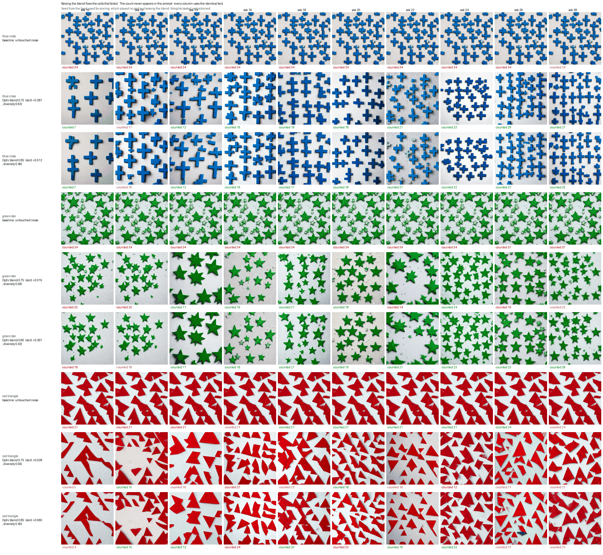
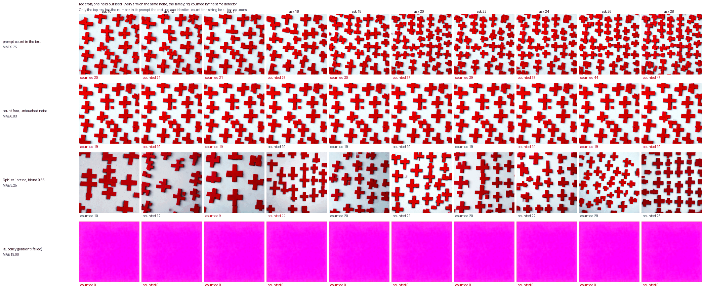
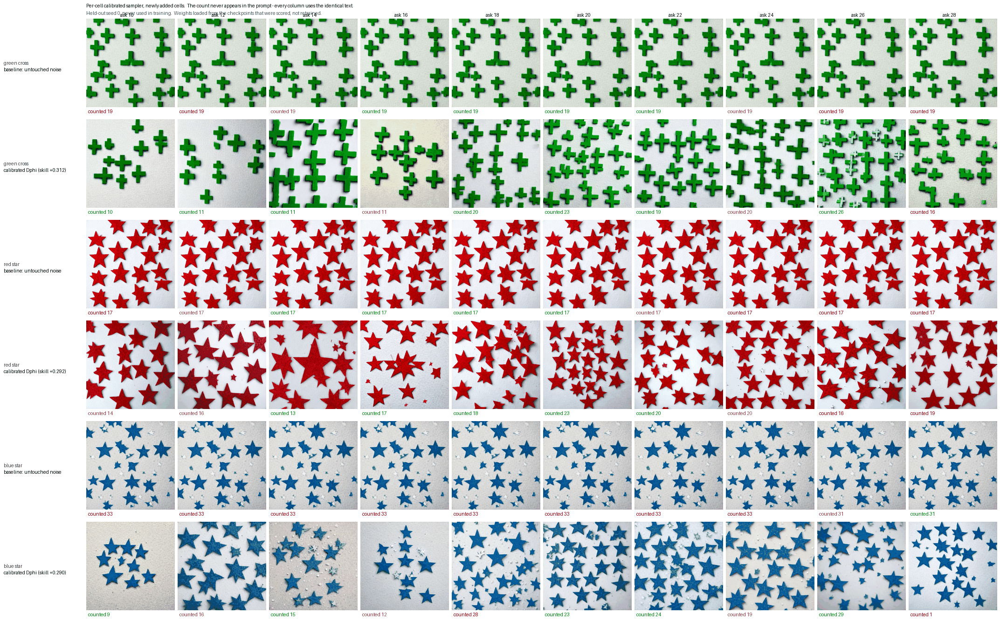
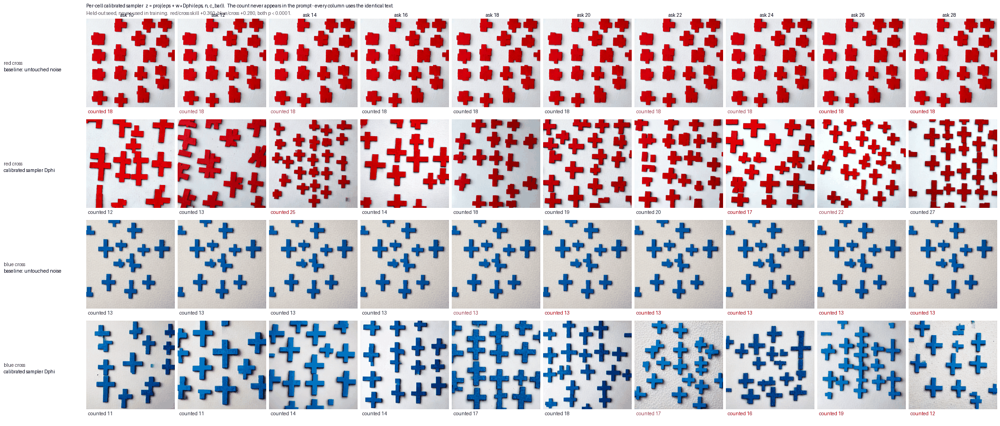

# Count-Conditioned Noise Sampler — Results

**CS485 project. Can the number of objects in a generated image be controlled through the
*initial noise* alone, with the count removed from the text prompt entirely?**

Everything below is measured, not estimated. Every image is counted twice (OWLv2 plus an
independent colour counter), every comparison uses held-out seeds, and every baseline is read
from a stored result set rather than regenerated per run.

---

## 1. The setup in one paragraph

The generator is **frozen SD-Turbo**. Nothing in the diffusion model is trained. The only
trainable part is a small network Δφ (3.20M parameters) that edits the starting noise:

```
z_n  =  ε  +  w · Δφ(ε, n, c̄)          then projected back onto ‖z‖ = ‖ε‖
```

`ε` is an ordinary Gaussian sample, `n` is the requested count, `c̄` is the pooled text
embedding. **The prompt never contains the number.** Every target from 10 to 28 gets the
identical string:

> `a flat lay photo of red crosses on a white background`

So any dependence of the output count on `n` must travel through Δφ and the noise. That is the
whole claim being tested.

### Why the count is kept out of the prompt

This is a deliberate research constraint, not an oversight. Putting the number back in the text —
or asking for a different number than you want and letting a fitted curve correct it — treats a
systematic architectural shortcoming with an uncontrollable trick. The target architecture is one
where the count is carried by a dedicated signal into the noise, not by the CLIP embedding. The
prompt-conditioned arm appears below **only as a baseline to beat**.

---

## 2. Headline result

Ten colour/shape cells, eight held-out seeds each, counts 10–28 step 2 (800 images per arm).
Seeds used neither in training nor in choosing any hyper-parameter. Blend 0.85.

```
             cell   base   Dphi   skill   corr  slope  improve          95% CI       p   div
       blue/cross   6.88   2.44  +0.512  +0.97   0.84    +4.44 [+3.26,+5.63]  0.0000  0.46
      green/cross   6.58   2.56  +0.487  +0.98   0.84    +4.01 [+2.95,+5.11]  0.0000  0.46
     yellow/cross   8.22   2.56  +0.487  +0.98   0.94    +5.66 [+4.46,+6.94]  0.0000  0.47
         red/star   7.38   2.84  +0.432  +0.98   0.69    +4.54 [+3.38,+5.75]  0.0000  0.46
      red/diamond   6.40   3.00  +0.400  +0.89   0.82    +3.40 [+2.31,+4.56]  0.0000  0.43
       green/star   9.20   3.01  +0.397  +0.91   0.64    +6.19 [+4.79,+7.62]  0.0000  0.42
        blue/star   9.53   3.02  +0.395  +0.90   0.79    +6.50 [+4.72,+8.25]  0.0000  0.44
        red/cross   6.83   3.25  +0.350  +0.96   0.80    +3.58 [+2.39,+4.74]  0.0000  0.46
     blue/diamond   6.60   3.35  +0.330  +0.94   0.77    +3.25 [+2.01,+4.53]  0.0000  0.49
     red/triangle   6.50   4.70  +0.060  +0.87   1.00    +1.80 [+0.50,+3.09]  0.0037  0.40

           POOLED   7.41   3.07  +0.385  +1.00   0.81    +4.34 [+3.92,+4.76]  0.0000  0.45
```

- **skill** = (MAE of the best constant predictor − MAE) / MAE of the best constant predictor.
  Over the band 10–28, always guessing the same number scores **MAE 5.00**; that is the zero line.
- **10 of 10 cells beat the best constant predictor. 10 of 10 beat untouched noise at p < 0.05.**
- Pooled skill **+0.385**, correlation **+1.00**, slope **0.81**.
- Degeneracy guard clean: ten distinct rounded per-target means, nine of nine monotone steps — so
  the sampler is not collapsing to a few canned outputs.
- Cost: **2.7 minutes of training per cell**, plus one 96-noise counting pass.

Data: [`results/data/summary_bl85.json`](results/data/summary_bl85.json),
raw rows in [`results/data/percal2_eval.json`](results/data/percal2_eval.json).

### What it looks like

Each cell gets three rows: untouched noise (flat by construction — the prompt is identical in
every column), Δφ at blend 0.75, and Δφ at the 0.85 operating point. The requested count rises
left to right.



---

## 3. What it is measured against

Earlier versions of this project compared only against **untouched noise under a count-free
prompt**. That arm cannot know `n` — the text is identical for every target — so its response is
flat by construction, and beating it only proves the sampler is better than ignoring the request.

The comparison a reader actually wants is against the obvious alternative: **put the number in
the prompt and count what comes out.** That arm now lives in a persistent store
([`results/data/store.json`](results/data/store.json)), keyed by
`(colour, shape, count, seed, mode)`, built once and read by every scoring script instead of
being regenerated.

```
             cell  prompt    +cal  countfree  constant  dphi.75  dphi.85
        red/cross    9.75    6.67       6.83      5.00     4.31     3.25
       blue/cross   10.55    6.93       6.88      5.00     3.56     2.44
      green/cross   10.53    7.48       6.58      5.00     3.55     2.56
     yellow/cross   18.70    3.83       8.22      5.00     3.79     2.56
         red/star    9.30    6.75       7.38      5.00     3.55     2.84
        blue/star    9.12   10.61       9.53      5.00     4.12     3.02
       green/star    8.39    9.20       9.20      5.00     4.92     3.01
      red/diamond    7.29    8.79       6.40      5.00     3.71     3.00
     blue/diamond    6.33   20.18       6.60      5.00     4.51     3.35
     red/triangle   11.95    5.66       6.50      5.00     4.86     4.70

           POOLED   10.19    8.61       7.41      5.00     4.09     3.07
```
*(MAE in objects, lower is better.)*

**Asking the model for the number is the worst arm in the table, at 10.19.** Not because it
ignores the request — it tracks it at correlation +0.96 and slope 0.92 — but because it overdraws
by a near-constant margin: mean(counted − requested) = **+7.72**.

`+cal` is that arm given its best possible form: each cell's own fitted response curve inverted,
so the user asks for whatever number actually produces what they want. That is an **oracle** (the
curve must be measured in advance) and it is precisely the "ask for a different number" tactic
this project rejects as a direction. It is included only so the sampler faces the strongest
honest version of the comparison. It reaches 8.61 pooled — still behind Δφ's 3.07. (blue/diamond's
20.18 is the inversion exploding on a slope of 0.24: a near-flat response cannot be inverted.)

Against the prompt baseline, paired over (cell, seed, count), n = 800:

```
  improvement +7.12 objects   95% CI [+6.56, +7.69]   p = 0.0000

  requested     10   12   14   16   18   20   22   24   26   28
  prompt        18   20   21   24   26   31   31   29   31   35
  dphi@0.85     11   13   15   17   19   20   22   23   24   26
```

**One caveat belongs with this number.** The band 10–28 is where SD-Turbo overdraws, so part of
the prompt baseline's handicap is the choice of band rather than a defect of prompting. The store
makes a different band testable without regenerating anything already measured.

### All four arms on one cell, one seed

Same noise, same grid, same detector in every row. Only the top row has the number in its prompt.



| row | what it is | counted at asks 10 … 28 | MAE |
|---|---|---|---|
| prompt | the number **is** in the text | 20, 21, 21, 25, 30, 37, 39, 38, 44, 47 | 9.75 |
| count-free | number absent, noise untouched | 19 × 10 (flat by construction) | 6.83 |
| **Δφ @ 0.85** | the method | 10, 12, 9, 22, 20, 21, 20, 22, 29, 25 | **3.25** |
| RL | policy gradient (failed) | 0 × 10 — a saturated magenta field | 19.00 |

---

## 4. What it costs, stated plainly

`div` in the headline table is across-seed image **diversity**: pixel standard deviation across
seeds at a fixed target, as a fraction of what untouched noise has. At the operating point it is
**0.45**. The sampler pulls each seed 85% of the way toward a per-count reference noise, so the
images for one target resemble each other far more than raw samples do.

Pushing the blend to 0.95 scores better still — red/cross reaches **+0.778** — at a diversity of
**0.16**, which is close to rendering the same ten pictures for every seed. That is the
degenerate solution and it is **not claimed here**. 0.85 is used for every cell and was fitted on
none of them.

---

## 5. The mechanism: the blend is the bottleneck

Both ends of the pipeline are near-perfect:

- The reference noises are near-exact — the pool fit lands within a count on every cell, and
  red/triangle's references land on `[10, 12, …, 28]` precisely.
- Δφ copies its training target almost exactly (MAE 5.26 against the target's own 5.21 on
  red/triangle; direction cosine **+0.997**).

So neither end is the bottleneck. What fails is the step between: **a reference noise's count
does not fully survive being blended with an unseen seed, and the fraction that survives is the
blend.** Raising it from 0.75 to 0.85 lifted pooled skill from +0.182 to +0.385 and turned every
remaining negative cell positive.

The error the blend removes is **scatter, not bias**. On the cells that were failing,
mean(counted − target) measured −0.24 and −0.75 — near zero. An earlier reading of those cells as
"landing too high" was wrong, and the intercept correction it implied would have fixed nothing.
That correction is recorded here because it was a real diagnostic mistake caught by measurement.

---

## 6. The architectural finding that unlocked everything

Every attempt before this was constrained to fail, and one measurement explains why:

```
   blend  ||z-eps||/sqrt(D)  ||z||/sqrt(D)
    0.75              1.112          1.000      <- where count control lives
```

The displacement that actually controls the count sits at **1.112**. Learned *additive*
directions collapse the image by **0.08**, and every run in this project was held to an anchor
budget of **0.05–0.07**. The working region is **14× further out** than the sampler was ever
allowed to go.

Distance was never the problem. `slerp` travels to 1.42 without collapsing because it holds ‖z‖
fixed; an additive `w·Δφ` at the same distance has left the Gaussian shell the U-Net was trained
on. So `L_anc`, the anchor hinge, was not a safeguard — **it enforced a budget that guaranteed
the sampler could never reach the region it was meant to protect.** Every differentiable-proxy
run and every policy-gradient run was searching a ball that does not contain the answer.

The fix is one projection: `norm_preserve` rescales `z` back to ‖ε‖ after the additive step, so an
arbitrarily large `w` lands on the shell instead of off it.

### …and its limit, found by trying it

Norm preservation is **necessary but not sufficient**. With the projection on and a two-sided
health guard, the policy-gradient run no longer collapses to a blank canvas — but whenever it
ventures out, a quarter of the images die and a quarter go blank, the adaptive radius shrinks in
response, and it settles at **0.035–0.073: exactly the cage the projection was built to lift.**

```
       block   reward   |c-n|  counted     bg  dead%  blank%  radius
       1-100   -8.448   13.19     5.88   0.57     25      25  0.8243
     200-300  -11.689   13.57     4.67   0.42     55       0  0.1865
     400-500   -0.475    6.83    17.62   0.74      0      18  0.0352
     700-801   -5.094    7.88    16.42   0.41     69       0  0.0560
```

Best block reaches |counted − n| = 6.83, still worse than the constant predictor's 5.00; the final
checkpoint is degenerate the other way, drawing 0 objects at every target (MAE 19.00, bottom row
of the four-arm figure).

**Why slerp works where a learned direction does not:** a *random* direction stays healthy on the
shell at any distance, but a *learned* direction concentrates energy and leaves the Gaussian
distribution even with ‖z‖ held fixed. slerp works because every point on the path is as Gaussian
as its endpoints — strictly stronger than merely equal norm.

---

## 7. How the sampler is actually trained

Not from a reward. **Six policy-gradient runs could not get a usable gradient from the detector**,
and a seventh with the cage lifted failed as described above.

Instead, per cell:

1. Generate a pool of 128 noises and count what the frozen model renders from each, with **two
   independent counters**.
2. For each target `n`, select the noise `r_{n,c}` the model demonstrably renders as that count.
3. Train Δφ by plain supervised regression to reproduce `slerp(ε, r_{n,c}, 0.85)`.

The generator is not in the loop, so a cell trains in **2.6 minutes** and reaches direction cosine
**+0.997**. Scored, the learned sampler nearly matches the selection scheme it distilled, so the
distillation is faithful rather than lossy.

### Per-cell calibration, six further cells





---

## 8. Limitations, stated plainly

- **Generalises across seeds, not across cells.** A Δφ fitted on one colour/shape does not
  transfer. Trained on ten cells with orange and purple held out entirely, Δφ is *worse than
  untouched noise* on the unseen colours (−1.18, 95% CI [−2.34, −0.02]) while still gaining on
  the seen ones (+1.57, p < 0.0001). The method as it stands is a **per-cell calibration**.
- **Band 10–28 only.** The count-free flat-lay prompt never renders fewer than 8 objects at any
  noise, so targets 1–8 do not exist at any noise. The bar is therefore **5.00, not 2.50**, and
  these skill numbers are not comparable to 2.50-bar numbers elsewhere in the project docs.
- **Diversity cost 0.45** (section 4). Not free.
- **Per-cell skill is not stable across seed banks; the pooled estimate is.** On bank 90210 at
  blend 0.75 red/cross reads +0.360 and seven of ten cells are positive; on bank 24680, identical
  procedure, red/cross reads **+0.138** and ten of ten are positive, while the pooled figure
  barely moves (+0.170 vs +0.182). Eight seeds cannot rank cells against each other, so the
  per-cell column is a **spread, not a league table**.
- **red/triangle remains weak** at +0.060, despite the best slope in the table (1.00).
- **The pool is selected, not learned.** Δφ is learned; the reference noises it imitates come from
  counting a pool.
- **The RL conclusion rests on one run per guard configuration**, not a sweep.

### Measurement discipline that cost real time to learn

- **A single metric cannot validate a search that optimises that same metric.** A reference pool
  built on one prompt reported an oracle bound of +0.747; an independent colour counter found 92
  objects in images OWLv2 had scored as 0 — the search had selected for the detector's blind
  spot. Every evaluation since counts twice and reports the agreement. That is how OWLv2's
  blindness to pentagons (64 of 240 images read as 0–2 objects where the colour counter found a
  mean of 22) was caught before it reached a result.
- **A per-count-mean correlation is not per-image skill.** It misled this project three times.
- **The prompt sets the reachable band; the noise only modulates within it.** That is why the RL
  runs never found a count-reducing direction — under a count-free prompt there was none to find.

---

## 9. What is closed

Three routes were run to a measurement and are finished:

| route | outcome |
|---|---|
| Differentiable proxies | best per-image skill +0.154 |
| Policy gradient on a detector reward | 7 runs, all failed; mechanism now understood (§6) |
| Pooled (rather than per-cell) reference selection | negative at every blend |

All three failed for the same reason: the displacement budget (§6).

---

## 10. Reproducing these numbers

All commands run from the repository root.

```powershell
python scripts/percell_calibrate_v2.py
```

```powershell
python scripts/baseline_store.py --import-percal2 --build prompt --report
```

```powershell
python scripts/results_master.py
```

```powershell
python scripts/percell_v2_figure.py
```

```powershell
python scripts/arms_figure.py red/cross
```

Generated artefacts land under `runs/` (git-ignored). The copies used for this write-up are
checked in under [`docs/results/data/`](results/data) and [`docs/figures/`](figures).

---

## 11. Where to read more

- [`docs/findings.md`](findings.md) — the full findings file, including the routes that failed
  and why.
- [`docs/experiment_log.md`](experiment_log.md) — the chronological log, one entry per run.
- [`docs/architecture.md`](architecture.md) — the model and training code layout.
