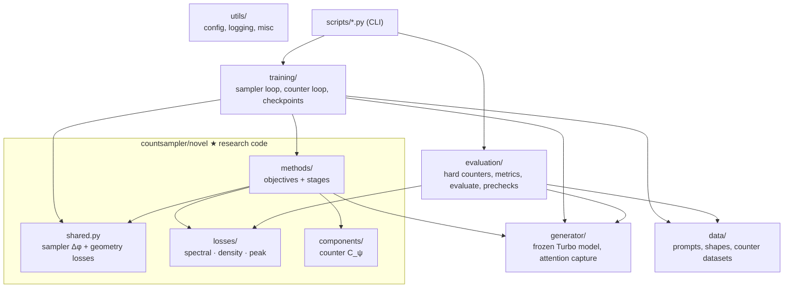
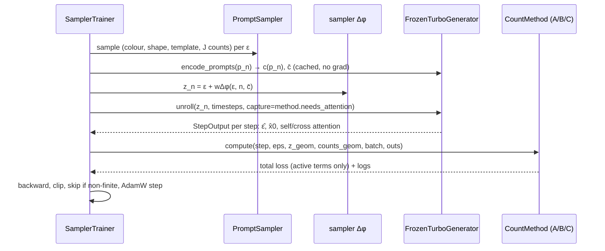

# Architecture

## Package map

Dependencies point one way: `novel/` uses `generator/` (to read attention and x̂0) and nothing in `training/` or `evaluation/`.
The research code can be tested on its own (`tests/test_losses.py`, `tests/test_shared.py`).

## One training step

`CountMethod.compute` (`novel/methods/base.py`):
1. For each selected unrolled step, calls the subclass's `method_terms(out, batch, step)` and averages the terms over steps.
2. Computes the shared terms `anc`, `pri`, `ord` on `z_geom` (the J sampled noises per ε, or all counts).
3. Sums `weight × term` over the terms active in the current stage. Inactive terms are still logged.

## Attention capture

`generator/attention.py` swaps a `CaptureAttnProcessor` into the requested layers (`FrozenTurboGenerator.watch`).
Three design points matter:

1. **Explicit softmax.** Fused SDPA kernels never materialise the probability matrix, so watched layers compute
   `softmax(QKᵀ/√d)` in float32 and record its head average. Unwatched layers keep the fast default.
2. **Same computation whether recording or not.** Gradient checkpointing re-runs the forward pass during backward and checks that the
   recomputation saves the same tensors. The processor therefore always takes the explicit path at watched layers.
   The store's `active` flag only controls whether results are recorded (it is off during recomputation).
3. **In the graph.** Recorded tensors are ordinary autograd tensors, so a loss on them backpropagates through the frozen
   U-Net to z_n. `tests/test_generator.py::test_gradients_reach_noise_through_attention_with_checkpointing` guards this.

`FrozenTurboGenerator.attention_layers()` does one dry forward pass with hooks to list every attention layer with its
type and token grid (`scripts/list_layers.py` prints it).

## Generator equivalence

With `generator.input_scaling=pipeline`, `FrozenTurboGenerator.unroll` reproduces diffusers' Euler "trailing" pipeline
(SD-Turbo's scheduler) exactly for 1, 2 and 4 steps (`tests/test_generator.py::test_unroll_matches_diffusers_euler_trailing`).
z_n = ε therefore gives the official frozen baseline.

## Extension points

| To add… | Do this |
|---|---|
| a method | subclass `CountMethod` (`novel/methods/base.py`): set `name` and `TERMS`, implement `method_terms` (and `attention_request` if it reads attention). Register it in `METHODS` in `novel/methods/__init__.py` and add `configs/method_<x>.yaml` |
| a loss term to a method | add the function in `novel/losses/<method>.py`, return it from `method_terms`, add it to `TERMS`, then add a weight and stage in the config |
| a hard counter (e.g. CountGD) | a class with `count(image, color, shape) -> CountResult` in `evaluation/hard_counters.py`, registered in `build_hard_counter` |
| a counter for Method B | anything with `count(x) -> [B, K]`. Pass it with `counter=` / `counter_meta=` to `DensityCountMethod` |
| a generator family | handle it in `FrozenTurboGenerator.from_pretrained` / `_encode_uncached` / `_model_output` (SDXL is the worked example: two text encoders, `added_cond_kwargs`) |
| a shape or colour | `SHAPES` / `shape_outline` / `COLOR_RGB` in `data/shapes.py`, and `HUE_RANGES` in `evaluation/hard_counters.py` |

## Reproducibility

- `experiment.seed` seeds Python, NumPy and PyTorch, the prompt sampler and the base-noise generator (which runs on the CPU, so noise matches across GPUs).
- Evaluation and previews derive each base noise from its integer seed, so the same seed gives the same ε in every run and for every method.
- Every run stores its resolved config, and sampler checkpoints embed it.
- The counter's latent cache file name is a hash of every setting that affects it.

## Tests

`tests/` builds a tiny random SD-style U-Net, VAE and CLIP text encoder with a fake tokenizer (`tests/conftest.py`),
so the whole pipeline runs on the CPU in seconds with no downloads:

| File | Covers |
|---|---|
| `tests/test_shared.py` | sampler identity at init, geometry losses (incl. Remark 1), finite gradients |
| `tests/test_losses.py` | spectral count on block attention, gap, masking, gradients; peak centres and suppression; density loss; frozen counter |
| `tests/test_generator.py` | layer scan, capture = default processor, Eq. 1, equivalence with diffusers' Euler pipeline, gradient through attention with checkpointing |
| `tests/test_data.py` | prompts, renderer vs hard counter, density targets, held-out combinations, config inheritance |
| `tests/test_pipeline.py` | training steps for A/B/C, stages, checkpoints, previews, evaluation, pre-checks, counter training, latent cache |
| `tests/test_docs.py` | docs drift: every config key is documented, and every linked file and code path exists |
