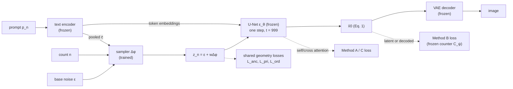

# Overview

## The problem

Text-to-image diffusion models are bad at numbers. Ask SD-Turbo for "seven red circles" and you
often get five, or nine. Earlier work ([5] in the spec) found that the **initial noise** largely decides the
layout, including how many objects appear. Many seeds have a "preferred" count they produce no matter what the prompt says.

## The idea

Leave the generator alone and learn to change its initial noise instead. A small network Δφ takes
the base noise ε, the requested count n and the pooled prompt embedding c̄, and returns a modified noise:

```math
z_n = \varepsilon + w\,\Delta_\phi(\varepsilon, n, \bar c) \qquad \text{(Eq. 2)}
```

The generator G (SD-Turbo or SDXL-Turbo: text encoder, U-Net and VAE) stays **frozen**. Only φ is trained.
Because Turbo models produce an image in one denoising step, a single U-Net forward pass yields both the
attention maps (read with hooks) and the clean estimate x̂0, and one backward pass through it trains φ.

## Pipeline



## How the gradient reaches the sampler

Every method-specific loss is computed from something the frozen U-Net produces from z_n:

| Method | Loss reads | Gradient path back to φ |
|---|---|---|
| A | self-attention probabilities S at one mid-resolution layer | S → U-Net layers up to that layer → z_n → φ |
| B | soft counts of the frozen counter on x̂0 | counter → x̂0 → ε̂ → whole U-Net → z_n → φ |
| C | the object token's cross-attention map ā | ā → U-Net layers up to that layer → z_n → φ |

This works because:
- the generator's parameters have `requires_grad=False`, but its forward pass is **not** wrapped in `no_grad`;
- attention probabilities are computed explicitly at the watched layers (`generator/attention.py`), so they stay in the autograd graph;
- gradient checkpointing (non-reentrant) recomputes activations during backward to save memory, and the capture processor computes the same thing on recomputation.

The shared geometry losses act on z_n directly and need no generator at all.

## The three methods

The spec defines three **separate** methodologies. They share the sampler and the geometry losses and differ only in
the error signal. Each is run and evaluated on its own first. Combining them is a later step.

| | A: spectral | B: density | C: peak |
|---|---|---|---|
| Signal | number of near-zero eigenvalues of the normalised Laplacian of the self-attention graph on the object's foreground | soft count Σ D_k of a frozen density counter on x̂0 | n separated, strong peaks in the object token's cross-attention |
| Extra module | none | counter C_ψ (trained once on synthetic shapes) | none |
| Grounded externally? | no (same network) | **yes** | no (same network) |
| Main risk | the network can agree with itself on a wrong count | the sampler exploits the counter | the cross-attention may not show separate peaks at all |
| Page | [method_a_spectral.md](methods/method_a_spectral.md) | [method_b_density.md](methods/method_b_density.md) | [method_c_peak.md](methods/method_c_peak.md) |

## Why the geometry losses are not enough

The shared losses ([shared.md](methods/shared.md)) keep z_n close to ε (L_anc), keep its norm where the
frozen model expects it (L_pri), and optionally arrange the noises for different counts by count distance (L_ord).
As Remark 1 notes, L_ord can be satisfied by moving along one fixed direction, which says nothing about counting.
**The count signal must come from Method A, B or C.**

## What is new and what is adapted

From §10 of the spec:

- **Proposed here, untested:** the sampler form (Eq. 2), the geometry losses, the spectral count and gap losses on the
  symmetrised self-attention graph, the stabilisation scheme, and the soft-centre repair of the peak losses.
- **Adapted from prior work:** noise modifier with a mixing weight and a norm prior (D2D, ReNO); reading instance
  structure from self-attention and the foreground from cross-attention (Make It Count); cross-attention blobs as count
  carriers (CountCluster); the log-ratio count scale (Counting Guidance).
- **Adapted from teammates' specs:** the density counter loss (Method B) and the peak losses (Method C).

In the code, everything new or adapted is in `countsampler/novel/`. See [architecture.md](architecture.md).
