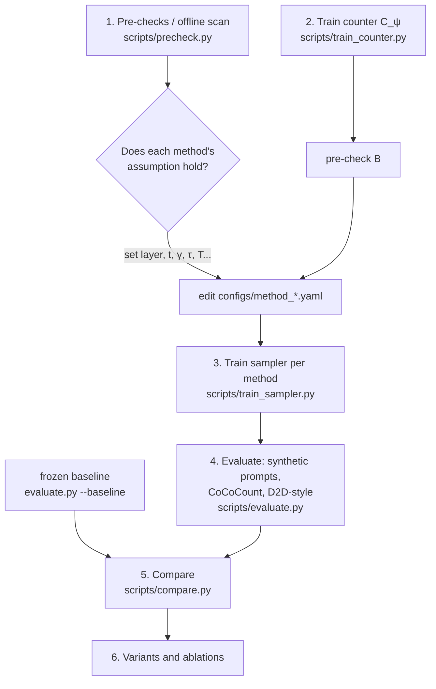

# Experiment workflow

This is the protocol from spec §7–§8, turned into commands. Each step says what to look at and what to decide.
Record every run in the [experiment log](experiment_log.md).



## 0. Smoke test

Run a 20-step training run once per machine to check memory and speed. See [setup.md](setup.md#first-gpu-smoke-run).

## 1. Pre-checks and offline scan (before any training)

Spec §8 asks for method-specific checks on the frozen model. §9 leaves the layer ℓ, timestep t and γ, τ, τ_a, T, K, ρ
to "an offline scan". One script does both:

```bash
python scripts/precheck.py --config configs/base.yaml --methods A C --out-dir runs/precheck
```

It uses two data sources (`precheck.sources`):
- **synthetic**: rendered scenes with known counts. Some have identical shapes and some touching shapes, as §8 asks.
  They are VAE-encoded and noised to each timestep in `precheck.timesteps`, so we can see how count information
  depends on t.
- **generated**: one-step samples of the frozen model from pure noise, which is exactly what training sees.
  The true count is what the hard counter finds in the decoded image.

**Method A.** Open `runs/precheck/precheck_A_summary.csv` (sorted by MAE). Each row is one combination of
(source, t, layer, affinity, γ, τ, T). Look for a configuration that:
- has low `mae` and high `pearson` on **both** sources (synthetic shows whether the signal exists, generated shows whether training will see it);
- works on the generated source at t = 999 (one-step training reads attention there).

Copy the winning layer into `method.attention.self_layers` and its `attn2` into `cross_layers`, and γ, τ, T into
`method.spectral.*`. If no configuration tracks the count, Method A's premise does not hold on this model.
Report that as a result.

**Method C.** Open `precheck_C_summary.csv` (sorted by `frac_peaks_ge_n`). This is the "first check" from Remark 4: how often the
object token's cross-attention has at least n separate peaks. If this fraction is low for n > 2, the method cannot work
as specified. Pick the layer, smoothing σ and threshold with the best fraction for `method.attention.*` and `method.peak.*`.

**Method B** is checked after the counter exists (step 2).

The scan is a grid: rows = samples × timesteps × layers × affinities × γ × τ × T. To make it faster, restrict
`precheck.resolutions`, `precheck.A.gammas`, etc. with `--set`.

## 2. Method B only: train the counter

```bash
python scripts/train_counter.py --config configs/counter.yaml
```

The first run renders 20 000 + 2 000 synthetic scenes and VAE-encodes them into `data_cache/counter/` (cached by a
hash of the relevant config). Training then runs for `counter.train.epochs`. Check the validation lines in
`runs/counter/log.jsonl`:
- `val/mae_present`, `val/exact_present`: counting accuracy on categories present in the image;
- `val/stray_mass`: predicted mass in absent categories (should be near 0);
- `val/mae_heldout_combo`, `val/exact_heldout_combo`: (category, count) pairs never seen in training (§4.1).

Then check that the counter reads **x̂0 of the frozen generator** (pre-check B):

```bash
python scripts/precheck.py --config configs/base.yaml --methods B --counter-ckpt runs/counter/counter_best.pt
```

If the `generated` rows are much worse than `synthetic` at t = 999, the synthetic-to-x̂0 gap is too large.
Harvest labelled generator samples and retrain, as §4.1 suggests:

```bash
python scripts/harvest_generator_samples.py --config configs/counter.yaml --out data_cache/counter/harvest.pt
```
```bash
python scripts/train_counter.py --config configs/counter.yaml --set "counter.dataset.harvested=[data_cache/counter/harvest.pt]" experiment.name=counter_h
```

## 3. Train the sampler, one method at a time

```bash
python scripts/train_sampler.py --config configs/method_a.yaml
```

Swap in `method_b.yaml` or `method_c.yaml` for the other methods. Each method's loss terms switch on in stages (`method.stages`), as the spec prescribes:

| Method | Stage 1 (step 0) | Stage 2 | Stage 3 |
|---|---|---|---|
| A | cnt, anc, pri | + gap (step 2000) | + ord (step 4000) |
| B | den, anc, pri | + ord (step 3000) | |
| C | act, supp, anc, pri | + rep (step 2000) | + ord (step 4000) |

What to watch in `runs/<name>/log.jsonl` (all keys are in [outputs.md](outputs.md)):
- the method's own diagnostics (`A/k_hat_abs_err`, `B/count_abs_err`, `C/frac_peaks_ge_n`) should improve;
- `geom/d_anchor_max` should stay at or below `geometry.delta`, and `geom/norm_sq` near 1;
- `skipped` should stay 0; `grad_norm` should not blow up;
- `previews/`: the sampler rows should start showing different object counts across columns.

The training-time diagnostics come from the **same signal** that is being optimised. They show that optimisation works,
not that counting improved. Only step 4 tells you that.

## 4. Evaluate

Run the frozen baseline once:

```bash
python scripts/evaluate.py --baseline --config configs/base.yaml --out-dir runs/eval_baseline
```

and each trained sampler:

```bash
python scripts/evaluate.py --ckpt runs/method_a/sampler_last.pt
```

The default split is `heldout`, i.e. shapes the sampler never saw in training (§7). Use `--split all` to see both.
The hard counter is independent of C_ψ, which matters for Method B (Remark 3).

Then the benchmarks §8 asks for (CoCoCount and the D2D benchmarks), with a detector counter. Details are in [benchmarks.md](benchmarks.md):

```bash
python scripts/prepare_benchmarks.py
```
```bash
python scripts/evaluate.py --baseline --config configs/base.yaml --benchmark cococount
```
```bash
python scripts/evaluate.py --ckpt runs/method_a/sampler_last.pt --benchmark cococount
```

Repeat with `--benchmark d2d_small`, `d2d_multi` and `d2d_large`. Use the same `--counter` for every run you compare.

## 5. Compare

```bash
python scripts/compare.py runs/eval_baseline runs/method_a/eval runs/method_b/eval runs/method_c/eval
```
```bash
python scripts/compare.py runs/eval_baseline_cococount runs/method_a/eval_cococount runs/method_b/eval_cococount runs/method_c/eval_cococount
```

Each prints a markdown table (one table per benchmark, if you mix them). Paste them into the experiment log. Besides accuracy, read:
- `seed_spearman_mean`: per seed, how well the counted value follows the requested n (§8's per-seed histograms, summarised). Near 0 for the baseline means seeds have a preferred count. A higher value after training means the sampler moved it.
- `nn_regularity_cv`: low values mean grid-like layouts, a possible sign of signal hacking (§8).
- `diversity`: if it collapses compared with the baseline, the sampler found a degenerate solution.

Always compare against the frozen baseline evaluated with the **same counter**. Without it there is
no way to tell a sampler that learned to count from a generator that was already roughly right.

## 1a. Perturbation probes (before trusting any geometry setting)

`geometry.delta` is marked OPEN in the spec and was never measured. Three probes on the frozen
model say what a bounded perturbation can and cannot do, and all three produced results that
changed the project:

```bash
python scripts/probe_perturbation.py --mode radius
```
```bash
python scripts/probe_perturbation.py --mode direction --ckpt runs/d_ord/sampler_step001000.pt
```
```bash
python scripts/probe_perturbation.py --mode leverage
```

- **radius**: a *random* displacement at the full delta = 0.3 budget leaves the image essentially
  unchanged (mean luminance 171.8 -> 167.2, corr(counted, n) +0.698 -> +0.749). Distance alone
  does not break the generator.
- **direction**: a *learned* displacement stops drawing scenes past **0.08**, while random
  survives 0.30+. `L_anc` constrains the wrong quantity, and no delta fixes it: any budget large
  enough to let the sampler act is large enough to let it destroy the image. Watch
  `geom/d_x0_*` (set `geometry.log_x0: true`), not `geom/d_anchor_*` - both Method D runs sat
  comfortably inside the anchor budget while drawing a flat colour block.
- **leverage**: how much count change exists inside the safe radius, along a slerp path between
  two real noises that cannot collapse by construction.

## 4a. Splitting generation from counting

`evaluate.py` runs OWLv2 on the same card as the generator, so the GPU idles behind the detector.
Generate on the GPU and count on the CPU instead:

```bash
python scripts/evaluate.py --ckpt runs/b_ord/sampler_last.pt --counter color --set eval.counter_kwargs={} --out-dir runs/b_ord/eval_gen
```
```bash
python scripts/count_grids.py runs/b_ord/eval_gen runs/b_ord/eval
```

The colour-counter numbers from the first command are discarded. **Resolution matters**:
`evaluate.py` counts the full 512 px decode but saves grids at `eval.grid_scale` (0.5 by default),
so a re-count of the grids is not the same measurement as that run's `records.csv`. Compare only
runs counted the same way - re-count both, or set `eval.grid_scale=1.0`.

## 4b. Prompt remapping (the calibration baseline)

The frozen generator hears the count and draws about twice too many, so to get m objects, ask for
the n whose output is closest to m. Fitted on half the seeds and scored on the others:

```bash
python scripts/remap_prompts.py runs/eval_baseline_white_s8 --out runs/remap_white_shape --by shape
```

It emits an ordinary evaluation directory, so `compare_paired.py` and `results_table.py` read it
unchanged. `--by shape` (30 free choices) is the measured best; `--by color_shape` (170 choices
against ~680 fit rows) overfits and scores worse than `--by global`. Any sampler should be
compared against this, not only against the raw baseline - it costs nothing to run and scores
skill +0.082 where the raw baseline scores -0.853.

## 5a. The results table

```bash
python scripts/results_table.py runs/eval_baseline_nms runs/d_white/eval --shapes
```

`compare.py` leads with MAE, which on this task is the most misleading number available. The frozen
generator over-counts, so a sampler that emits almost nothing scores *well* on MAE while carrying
no count information: Method C improved MAE by 2.855 against the baseline it was measured on,
significant on a paired test, while producing 0.19 objects per image and 82 % empty images.

`results_table.py` leads with the quantities that separate counting from not counting — **spread**
(what the ceiling analysis says must roughly halve), **slope per shape** (the aggregate hides that
cross is +1.91 and pentagon −0.65 on the frozen baseline), and the **counted mean and zero rate**,
where a degenerate run is obvious and nowhere else. It marks such runs **⚠ degenerate** rather
than letting a good MAE speak for them.

## 5b. Record the result

`compare.py` gives the cross-run headline. For the full record of a single run — environment,
resolved config, checkpoint hashes, per-stage training curves and the complete metrics including
the per-count breakdown — use:

```bash
python scripts/report_run.py runs/method_c --out docs/results/method_c.md
```

It also prints the quantity `compare.py` cannot: the **best-constant-predictor MAE** on the very
same records, and the skill score `1 − MAE/bar`. A sampler that ignores the prompt still posts a
finite MAE, so a raw MAE on its own never establishes that counting works. Keep the generated
reports in [results/](results/README.md) and put the headline row in
[experiment_log.md](experiment_log.md).

## 6. Variants and ablations

All variants are config overrides. Use a distinct `experiment.name` for each.

| Experiment | Command suffix | Spec |
|---|---|---|
| g_lin instead of g_log in L_ord | `--set geometry.g=lin experiment.name=a_glin` | §3.4 "run g_log and g_lin separately" |
| ranking form of L_ord | `--set geometry.ord_form=rank` | Eq. 6 |
| number removed from the prompt | `--set data.include_count=false experiment.name=a_nonum` | §7 ablation |
| cosine-of-features affinity (A) | `--set method.spectral.affinity=feature_cosine` | Remark 2 fallback |
| first two steps instead of one | `--set "generator.timesteps=[999,499]"` | §1 |
| image-space counter (B) | retrain the counter with `--set counter.input_space=image` | §4.1 |
| SDXL-Turbo | add `--config configs/sdxl_turbo.yaml` | §1 |
| several seeds | `--set experiment.seed=1 experiment.name=a_s1` | |

## Naming runs

Use `<method>_<variant>_s<seed>`, e.g. `a_glog_s0`, `b_tol025_s1`, `c_nonum_s0`. Every run directory holds its full
resolved `config.yaml`, so a run can always be reproduced from its directory.
